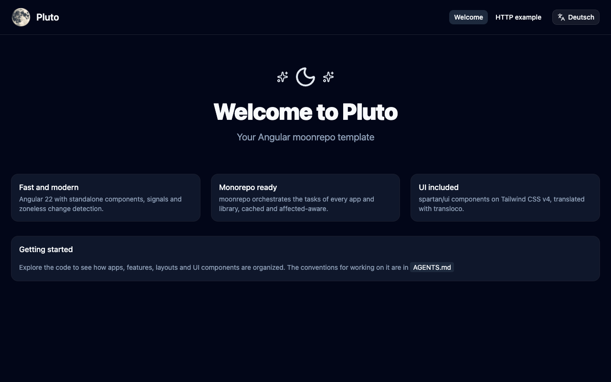

<br>
<h1 align="center">
  
  <br>
  <br>
  Pluto, the Angular moonrepo template
</h1>

<p align="center">
  <strong>Launch your Angular projects into orbit with the power of moonrepo!</strong>
</p>

<p align="center">
  <a href="https://additive.github.io/moonrepo-template-pluto/">Live demo</a> •
  <a href="#whats-inside">What's inside</a> •
  <a href="#quick-start">Quick start</a> •
  <a href="#architecture">Architecture</a> •
  <a href="#ai-assisted">AI assisted</a>
</p>

<br>

**Pluto** is a production-ready Angular monorepo template powered by
[moonrepo](https://moonrepo.dev). Because every great Angular project deserves a moon!

It comes straight out of real enterprise applications. We run several customized apps for
our customers on one shared core, and Pluto is that core with the customer parts taken out.
Start with one app, grow into a whole constellation, and keep a single set of libraries,
conventions and tools for all of them.

<p align="center">
  
</p>

## Why Pluto

- **Current from day one.** Angular 22, zoneless, signals and standalone components. No
  NgModules, no zone.js, no legacy to migrate away from.
- **A monorepo that scales.** moonrepo caches every task and runs only what a change
  affects, so lint, test and build stay fast as apps and libraries pile up.
- **UI that is already there.** spartan/ui components on Tailwind CSS v4, vendored into the
  repo so they are yours to read and change. Light and dark themes come with it.
- **Two languages out of the box.** transloco with English and German, a language switch
  in the layout and translated page titles. A check keeps every language complete.
- **Fast, strict tooling.** oxlint and oxfmt lint and format the whole workspace, Angular
  templates included. TypeScript runs in its strictest settings.
- **Safe dependencies.** Packages install through Socket Firewall, fresh releases wait three
  days before pnpm takes them, and gitleaks scans every commit for secrets.
- **Ready for AI agents.** `AGENTS.md` gives coding agents the same conventions a new
  developer gets.

## What's inside

| Category                 | Tools                                                    |
| ------------------------ | -------------------------------------------------------- |
| **Framework**            | Angular 22 (zoneless, signals), TypeScript 6             |
| **Task orchestration**   | moonrepo 2, moon generator templates, proto, just        |
| **UI**                   | spartan/ui, Tailwind CSS v4, ng-icons (Lucide)           |
| **i18n**                 | transloco (English, German)                              |
| **Code quality**         | oxlint (type-aware), oxfmt, commitlint, gitleaks         |
| **Testing**              | Vitest through the Angular unit test builder             |
| **Package management**   | pnpm 11, Node.js 24, Socket Firewall                     |
| **Developer experience** | editorconfig, VS Code and Zed settings, HTTPS dev server |
| **Deployment**           | GitHub Pages workflow, Caddy and Docker Compose setup    |

## Quick start

You need [proto](https://moonrepo.dev/proto), which installs every other tool in the
pinned version, and [mkcert](https://github.com/FiloSottile/mkcert) for the local HTTPS
certificates.

```bash
# Install the tools and dependencies
just setup

# Start the dev server on https://localhost:4200
just dev

# Lint, test and build
just lint
just test
moon run pluto:build
```

Run `just` on its own to list every recipe. To add a feature library with a routed page,
run `moon generate feature`.

## Architecture

```
pluto/
├── apps/
│   └── pluto/          # The Angular app
└── libs/
    ├── app-*           # Core libraries every app shares
    ├── feature-*       # Routed features an app mounts
    ├── ui-helm/        # spartan/ui components
    ├── moon-project/   # moon.yml project data in app code
    └── types/          # Global TypeScript types
```

A library declares what it depends on in its `moon.yml`. moon writes that into each
`package.json` and `tsconfig.json`, so imports like `@pluto/helm/button` or
`@pluto-feature/example/example-routes` just work.

### Core libraries (`app-*`)

| Library           | Purpose                                  |
| ----------------- | ---------------------------------------- |
| `app-assets`      | Assets shared across apps                |
| `app-build`       | Build plugins, index.html transform, CSP |
| `app-config`      | Providers every app shares               |
| `app-environment` | Environment configuration                |
| `app-http`        | HTTP client and interceptors             |
| `app-i18n`        | Translations, locale files, page titles  |
| `app-layout`      | The app shell with menu and language     |
| `app-theme`       | Tailwind setup and the spartan/ui theme  |

### Feature libraries (`feature-*`)

| Library             | Purpose                               |
| ------------------- | ------------------------------------- |
| `feature-welcome`   | Welcome page                          |
| `feature-example`   | `httpResource` loading data on demand |
| `feature-not-found` | 404 page                              |

### Other libraries

| Library        | Purpose                                    |
| -------------- | ------------------------------------------ |
| `ui-helm`      | spartan/ui Helm components, vendored       |
| `moon-project` | An app's `moon.yml` project block, typed   |
| `types`        | Global types, resets and build-time values |

## AI assisted

This template is developed by our engineers by hand, with care. We use local LLMs with
[opencode](https://github.com/opencode-ai/opencode) as an assistant for enhancements, not
as a replacement for thoughtful development.

Claude is only used in this public repository, so it benefits from AI help too. Everything
is reviewed by hand when we sync improvements back into our internal project.

## About

Pluto is developed and maintained by [ADDITIVE GmbH](https://www.additive-net.de), a
certified technology company specializing in high-end engineering solutions. We build
web-based applications, quality management systems and digital laboratory solutions for
enterprises across many industries.

This template powers our internal multi-tenant applications. It lets us deliver customized
solutions to our customers while keeping a shared, well-tested core.

Learn more about our [solutions and services](https://www.additive-net.de/de/solutions).

## License

[MIT](LICENSE)

<br>

<p align="center">
  Made with care by <a href="https://www.additive-net.de">ADDITIVE GmbH</a>
  <br>
  <sub>To the moon!</sub>
</p>
